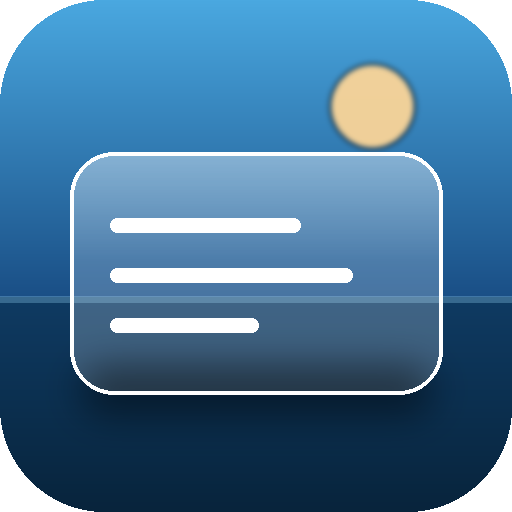

# VSCode-Wallpaper

给 VS Code 加自定义静态 / 动态壁纸 —— 支持 **Wallpaper Engine 的 `scene.pkg` 实时渲染**、毛玻璃与浮层布局。

[English](README.md) | 简体中文



## 功能

- **壁纸**：单张图片、视频、网页，或整个文件夹（乱序 + 定时轮播）。
- **Wallpaper Engine**：跟随**当前**壁纸，或从壁纸库里锁定一张。支持 `video`、`web` 和 **`scene.pkg`（WebGL2 实时渲染）**。
- **毛玻璃**：可调模糊 / 不透明度 / 饱和度，作用于标题栏、活动栏、侧栏、编辑器、面板、辅助栏、状态栏、标签页；每个区域可单独开关，还能分区微调亮度。
- **浮层布局**：打开 VS Code 官方的 *Modern UI*，再由本插件接管样式（卡片间距、统一圆角、接缝处理）。
- **壁纸自带设置面板**：读取当前 WE 壁纸 `general.properties`，在侧边栏生成对应控件（bool / slider / combo），例如**鼠标拖尾**、**壁纸视差**、**雨**、**音频条**。

## 安装

### 从 VSIX

```bash
code --install-extension vscode-wallpaper-glass-1.0.0.vsix --force
```

### 从源码

```bash
npm install
node esbuild.js
npx @vscode/vsce package --allow-missing-repository --skip-license
code --install-extension vscode-wallpaper-glass-1.0.0.vsix --force
```

> 装上新版本后**要重载两次窗口**：第一次让扩展重写 `workbench.html`，第二次才是页面真正读到它。

## 快速开始

1. 在活动栏打开 **VSCode-Wallpaper** 视图（或运行命令 `控制面板`）。
2. 打开**启用壁纸**。
3. 选来源：*文件* / *文件夹* / *跟随 Wallpaper Engine* / *WE 壁纸库*。
4. 按喜好调毛玻璃、布局、圆角。
5. 点**重载窗口**（`vsw.autoReload` 开着时面板会自动帮你重载）。

## 实现原理

VS Code 的工作台就是一个 `workbench.html` 页面，扩展往里面注入一小段运行时：

- 固定定位的 `#vsw-stage` 层（`z-index: 0`），里面放图片 / 视频 / iframe / canvas；
- 把工作台背景改透明的 CSS，并给各个面板加 `backdrop-filter`；
- 用内联 `!important` 背景覆盖，压过主题写在元素上的内联样式；
- 临时改写 `workbench.colorCustomizations` 并保存原值（还原时恢复）。

`scene.pkg` 由运行时挂载 [webwallgl](https://github.com/oneincase/webwallgl)（MIT，WebGL2）。pkg 字节被转成 base64 的 JS 文件、用 `<script src="vscode-file://…">` 加载 —— 因为在 VS Code 渲染进程里 `fetch`/`XHR` 访问不到 `http://127.0.0.1`，而自定义的 `vscode-file:` 协议也不支持 fetch。

## 设置项（节选）

| 设置 | 默认值 | 说明 |
| --- | --- | --- |
| `vsw.enabled` | `false` | 总开关。 |
| `vsw.wallpaper.source` | `file` | `file` / `folder` / `wallpaperEngine`。 |
| `vsw.wallpaper.file` | `""` | 图片、视频或 `scene.pkg`。 |
| `vsw.wallpaper.folder` | `""` | 轮播用的文件夹。 |
| `vsw.wallpaper.sceneMode` | `live` | `live` 真渲染 `scene.pkg`；`preview` 退化为 `preview.gif/jpg`。 |
| `vsw.wallpaper.sceneProps` | `{}` | 每张壁纸的用户属性（在面板里调）。 |
| `vsw.glass.enabled` | `true` | 毛玻璃开关。 |
| `vsw.glass.blur` | `24` | 模糊半径（px）。 |
| `vsw.glass.opacity` | `0.5` | 面板底色不透明度。 |
| `vsw.glass.regions` | 8 个区域 | 哪些区域加玻璃。 |
| `vsw.layout.radius` | `0` | 窗口圆角。 |
| `vsw.layout.panelRadius` | `12` | 侧栏 / 编辑区圆角。 |
| `vsw.debug` | `false` | 在壁纸层显示调试日志框。 |

完整列表见 *设置 → 扩展 → VSCode-Wallpaper*。

## 已知限制

- Windows 上右上角三个窗口按钮由 Electron 的 `titleBarOverlay` 绘制，CSS 改不了。
- 很窄的元素没法和大面板做成同样的磨砂质感：`backdrop-filter` 取的是背后的平均值，44px 宽的活动栏一定比 300px 宽的侧栏更「平」。
- 依赖重度 GPU 效果的 scene 壁纸，可能比在 Wallpaper Engine 里慢一些。

## 开发

```bash
npm install
node esbuild.js        # src/extension.ts -> dist/extension.js，src/media/loader.ts -> dist/loader.js
npx tsc --noEmit       # 类型检查
```

`src/media/loader.ts` 是注入到工作台页面里的运行时，其余代码都跑在扩展宿主里。

## 致谢

- [webwallgl](https://github.com/oneincase/webwallgl) —— WebGL2 的 Wallpaper Engine 渲染器（MIT）。
- [vscode-background](https://github.com/shalldie/vscode-background) —— HTML 注入思路的启发。

## 许可证

MIT
